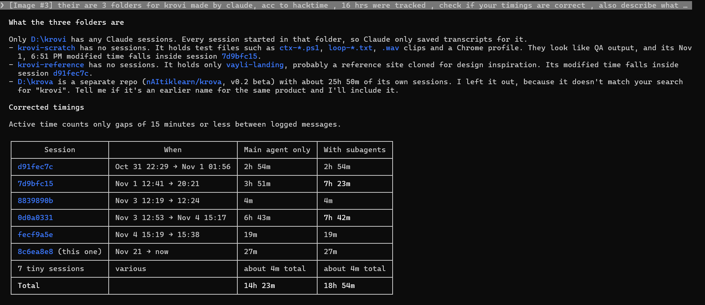
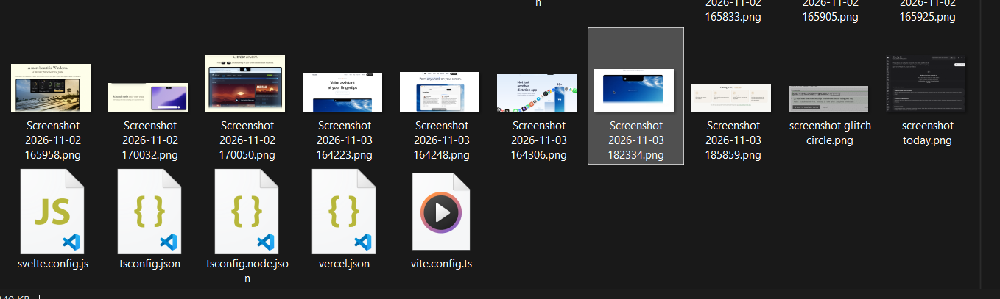
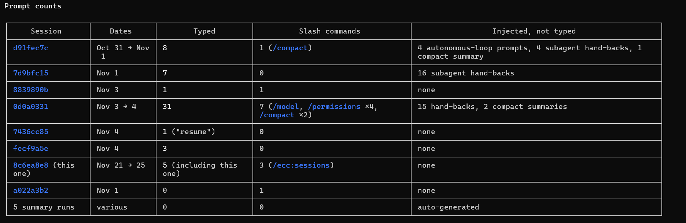

# KROVI
THIS IS HOW I made **Krovi**

Krovi was made in total 6 main sessions , using multiple sub agents and pluggins

I got the idea from X where someone made a notch typa thingy like in ios , to manage things from one space , I had some issues with that project . 
1- It was paid , I believe productive apps  should be free .
2 - It was only for mac
3 - not open source 

So I made krovi , It has around 19 features , out of which cleanmyOS , file shelf, circle to ask are my fav 
## WHY ITS BETTER?
1- its open source 
2- the notch is custamizable , multiple themes and eyes looks .
3 - its free

## how I made it ?

I used claude code for making the entire thingy , Ill add the screenshots of what each session did

I also provided various websites ui designs for getting a good website for krovi .

The session In which i gave more prompts were the main ones where most of the work was done .
some were very short because of api error and storage issue(potato laptop)

