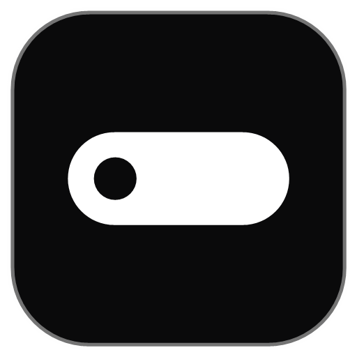

<p align="center">
  
</p>

<h1 align="center">Krovi</h1>

<p align="center">
  <strong>One pill at the top of your screen. Every little tool inside. Your data stays on your PC.</strong><br>
  A free, open-source "everything shelf" for Windows — 15 daily tools behind one global hotkey,
  summoned as a small pill that springs open into a panel.<br>
  Local-first. No accounts, no telemetry, no paywall.
</p>

<p align="center">
  <a href="https://github.com/nAItiklearn/krovi/releases"></a>
  <a href="https://github.com/nAItiklearn/krovi/actions/workflows/ci.yml"></a>
  
  
  
  <a href="https://web-k7ipwn7fd-naitiklearns-projects.vercel.app/"></a>
</p>

<p align="center">
  <a href="https://web-k7ipwn7fd-naitiklearns-projects.vercel.app">Website</a> &middot;
  <a href="https://web-k7ipwn7fd-naitiklearns-projects.vercel.app/demo/">Try it in your browser</a> &middot;
  <a href="https://github.com/nAItiklearn/krovi/releases">Download</a> &middot;
  <a href="https://web-k7ipwn7fd-naitiklearns-projects.vercel.app/changelog">Changelog</a>
</p>

---

> [!WARNING]
> **Early preview.** Krovi works and its automated tests all pass (483 Rust, 533 UI), but it is
> QA'd hands-on on one Windows 11 PC, by one person, in English. Expect rough edges: clipboard
> and media behaviour depend on the apps you use, a few reminder/voice flows were verified only
> in demo builds, and the on-device voice recognition is only as good as Windows SAPI (struggles
> with female voices, noise and uncommon names — measured limits are documented in
> [`docs/DECISIONS.md`](docs/DECISIONS.md)). **Do not rely on it for important work yet.**
> There is no macOS or Linux version.

## v0.2 "Island" highlights

**The panel became a pill, and everything on it became live.** New: a top-of-screen Island,
live clipboard and media, real reminders, 100% on-device voice commands, Explain, Quick
Transfer, offline holidays, checklists, six themes — and a completely redesigned website
with a full changelog entry for
[v0.2](https://web-k7ipwn7fd-naitiklearns-projects.vercel.app/changelog).

| Addition | Detail |
|---|---|
| **The Island** | a pill at the top-centre of your screen that morphs into the 15-tool panel and back; never blocks the app underneath, folds away with <kbd>Esc</kbd>, a click elsewhere or the hotkey |
| **Live clipboard** | copies appear within a fraction of a second; password-manager entries are never stored |
| **Live now playing** | title, artist, artwork and a ticking progress bar from the Windows media session, with play/pause/next/prev |
| **Real reminders** | a timed calendar entry rings: Windows notification + sound, snooze 5/10, dismiss, missed-while-closed catch-up, Do-Not-Disturb aware |
| **Voice (100% on-device)** | dictate notes; a closed grammar of spoken commands: open any tool, timer/Pomodoro control, media, launch an app or open a folder, list a folder, find a file, set a reminder. Windows SAPI, zero network — verified by a socket capture |
| **Explain** | on-device text summary + read aloud (short/medium/key points); optional bring-your-own ElevenLabs key, stored in Windows Credential Manager |
| **Quick Transfer** | send files PC ⇄ phone over your own Wi-Fi with a QR code, optional PIN, no cloud relay |
| **Holidays, offline** | India, US and GB holidays 2025–2027 bundled with documented sources |
| **Checklists in Notes** | tick-boxes inline between paragraphs |
| **Six themes + idle companion** | Graphite, Porcelain, Mochi, Arcade, Terracotta, Tide — or follow Windows; the pill rests as a pair of eyes that wake when you touch it |

## All 15 tools

| | |
|---|---|
| **Clipboard history** | searchable, pin-to-top, type filters, capped ring |
| **Paste stack** | 9 explicit numbered slots (push/pop) |
| **Timers & stopwatch** | multiple countdowns + laps |
| **Pomodoro** | work/break cycles on the timer engine |
| **File shelf** | park files on named shelves, drag out |
| **Media now-playing** | reads the Windows media session; transport controls |
| **Quick Transfer** | send files PC ⇄ phone over your LAN with a QR code, optional PIN |
| **Calendar** | real reminders + bundled offline holidays (IN / US / GB, 2025–2027) |
| **Weather** | keyless API + coarse location |
| **Quick notes** | fast scratch notes, tick-box checklists, voice dictation |
| **Explain** | on-device summaries + read aloud (optional ElevenLabs voices) |
| **World clocks** | several zones at a glance |
| **Unit & currency** | offline units; cached keyless FX |
| **Calculator** | expression + unit-aware |
| **Screen-time** | local-only per-app/day (no titles/URLs, never sent) |

A keyboard-first command palette sits above all of them (<kbd>Ctrl</kbd>/<kbd>Cmd</kbd>+<kbd>K</kbd>),
and the voice grammar drives the same actions by name.

## Performance (measured on a real install)

Measured on the installed NSIS build, Windows 11, pill idle with the idle companion on —
method and full tables in [docs/PERF.md](docs/PERF.md):

| Path | Measured |
|---|---|
| <kbd>Ctrl</kbd>+<kbd>Alt</kbd>+<kbd>Space</kbd> → panel expanded | 46–69 ms |
| OS clipboard copy → shown in the open panel | < 0.9 s |
| Media track change → shown in the open panel | < 1.2 s |
| Quick Transfer, 5 MB over LAN | 0.027 s |
| Idle CPU | 0% pill; ~1% of one core while the eyes are awake |
| **Idle private memory** | **~136 MB total** — 6.3 MB is the Rust process; the rest is the WebView2 runtime keeping the always-visible pill rendered |

Honest note: that memory number is higher than we'd like (the always-rendered pill costs a full
webview). Rendering the pill natively and building the panel webview on demand would cut most of
it, and is the main known optimisation not yet done.

## Privacy

Krovi sends nothing about you anywhere. Every outbound call is grep-backed and documented in
[`docs/SECURITY-network-audit.md`](docs/SECURITY-network-audit.md): optional keyless weather,
a city-name search and exchange rates, plus — only if you add your own key — ElevenLabs
read-aloud, which sends the text being read. Voice commands make **zero** network calls.
Quick Transfer runs a server on your own LAN only while a share is open. No telemetry, ever.

## Website

🌐 **https://web-k7ipwn7fd-naitiklearns-projects.vercel.app/** — features, the live browser demo, full voice
documentation, an honest comparison vs. alternatives, and the changelog.

## Download

Grab the Windows installer from **[GitHub Releases](https://github.com/nAItiklearn/krovi/releases)**.
Installers (NSIS + MSI) are built on Windows/MSVC by GitHub Actions when a `v*` tag is pushed —
[`v0.2.0`](https://github.com/nAItiklearn/krovi/releases/tag/v0.2.0) is current.

## Try the UI right now (browser demo, no backend)

The panel runs in a plain browser in demo mode (fixtures, no Rust side needed):

```sh
git clone https://github.com/nAItiklearn/krovi
cd krovi
npm install
npm run dev        # → http://localhost:5173
```

or just open **[the hosted demo](https://web-k7ipwn7fd-naitiklearns-projects.vercel.app/demo/)**. Every tool view
is interactive (the calculator computes, timers tick, voice help lists every phrase,
Ctrl/Cmd+K opens the command palette).

## Build from source

Frontend: `npm install` then `npm run build` (tests: `npm test`; types: `npm run check`).

Rust core (pure logic, no native toolchain needed):

```sh
cargo test --manifest-path src-tauri/Cargo.toml -p krovi-core -p krovi-store -p krovi-net -p krovi-sys
```

Full native app / installer: needs a **64-bit MSVC C toolchain** (Visual Studio Build Tools,
C++ workload) with `rustup default stable-x86_64-pc-windows-msvc`. Build with the integrations
enabled:

```sh
cargo tauri build --features net,native
```

> Note: an `x86_64-pc-windows-gnu` host with only 32-bit MinGW cannot compile the native app
> (fails in `dlltool`/bundled-C) — documented in [`docs/DECISIONS.md`](docs/DECISIONS.md) D-009.
> CI uses MSVC, which is why the downloadable installer is produced by GitHub Actions.

## Architecture

```
src/                     Svelte 5 + Vite + TS panel UI (demo-mode capable, 533 tests)
src-tauri/               Tauri 2 shell (pill/panel window model)
  src/                   thin #[tauri::command] bridge (no business logic)
  crates/krovi-core/     pure logic: clipboard, timers, pomodoro, notes, todo, shelf, screentime, calendar
  crates/krovi-store/    persistence: Store trait + in-memory + SQLite (feature-gated)
  crates/krovi-net/      the ONLY outbound calls — keyless weather + currency
  crates/krovi-sys/      windows-rs wrappers (media, clipboard, foreground window, location)
  crates/krovi-voice/    on-device speech: SAPI engine, grammar, parser, OS intents
  crates/krovi-explain/  on-device summaries + read-aloud
  crates/krovi-transfer/ LAN transfer server (QR, PIN)
web/                     the marketing/docs/changelog site (static, zero third-party requests)
docs/                    SPEC, ADRs, decision log, network audit, PERF
```

Two ownership rules keep it honest: the command bridge holds no business logic, and every
network call lives in exactly one crate. See [`docs/ADR-001-stack.md`](docs/ADR-001-stack.md)
and [`docs/SPEC.md`](docs/SPEC.md).

## Contributing

Issues, ideas, and pull requests are welcome. Please keep changes local-first and
privacy-preserving, and add tests — the CI gates on them.

## License

[MIT](LICENSE) © 2026 Naitik Sahu and the Krovi contributors.
